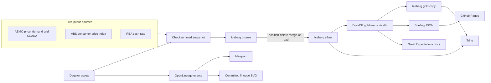

# AI grid pressure

[](https://github.com/LuciferDataEngineer/ai-grid-pressure/actions/workflows/ci.yml)
[](https://luciferdataengineer.github.io/ai-grid-pressure/)

Live briefing: **[luciferdataengineer.github.io/ai-grid-pressure](https://luciferdataengineer.github.io/ai-grid-pressure/)**

Australia's public investment pipeline is being talked about at about **$1.39 trillion**, including about **$141 billion** of data-centre projects (Deloitte Access Economics, 5 November 2026). That dollar figure is context from the public headline. It is **not** loaded as a fact table and it is not a megawatt forecast.

The operating question for energy ministers, the Australian Energy Regulator, and households is narrower, and it can be answered with free public data:

**Where is grid stress showing up on the National Electricity Market while that build-out is being discussed, and how does the pressure show up in wholesale prices and in household electricity prices?**

This repository answers with measured regional demand, wholesale prices, a recent metered fuel mix, the electricity consumer price index, and the Reserve Bank cash rate. The market data does not label data-centre load. The briefing says so in plain language.

<!-- FACTS:START -->

- Highest state demand in the extract: **13,159 MW** in **New South Wales** at 1 Jul 2025, 5:50pm NEM time.
- Highest whole-market demand (five regions added): **33,674 MW** at 16 Dec 2024, 5:30pm NEM time.
- Highest wholesale price: **$23,200 per megawatt-hour**, reached 2 times (Tasmania at 13 Jul 2026, 4:20pm NEM time; New South Wales at 10 Oct 2026, 7:20am NEM time).
- Since 8 Aug 2026, **New South Wales** had the most prices at or above $300: **88** five-minute periods (0.34% of the time).
- **South Australia** had the most prices below zero: **6,760**.
- Last-90-day evening average wholesale price **$86.32**, middle-of-day average **$21.64**.
- Metered renewable share 22 Oct 2026 to 4 Nov 2026: **37.0%** (batteries excluded; rooftop solar not in the file).
- National electricity CPI rose **10.6%** over the year to 2026-Q3; all-groups CPI rose **3.9%**.
- RBA cash rate target **4.85%** on 5 Nov 2026. It moved from 4.60% on 4 Nov 2026.

<!-- FACTS:END -->

Deeper write-up: [INSIGHTS.md](INSIGHTS.md).

## Architecture



Dagster is the orchestrator. Each asset emits an [OpenLineage](https://openlineage.io/) complete event. Events are always written to `docs/lineage/`. If `OPENLINEAGE_URL` is set (Marquez's API, usually `http://localhost:5000`), they are posted as well. Great Expectations data docs are published at [`docs/gx/`](docs/gx/index.html).

## What's new vs housing-slump-radar

The previous project (`housing-slump-radar`) used ClickHouse and Redpanda in Docker Compose, versioned data-mesh contracts, dbt-duckdb, Dagster, and a static ECharts briefing on ABS, RBA and DataVic.

This project keeps Dagster, dbt-duckdb and a tabbed static briefing, and changes the platform:

| Piece | housing-slump-radar | this project |
| --- | --- | --- |
| Lake | ClickHouse tables | **Apache Iceberg** bronze and silver, format v2 |
| Changes to landed files | Reload / mesh contracts | **Merge-on-read position deletes** so data files stay put |
| SQL besides DuckDB | ClickHouse | **Trino** over the Iceberg catalog, checked against DuckDB |
| Lineage | Not a first-class run | **OpenLineage events and Marquez** |
| Quality | dbt tests | dbt tests **and Great Expectations** suites with committed data docs |
| Serving marts | DuckDB | **DuckDB remains the gold warehouse** and the briefing export |
| Streaming bus | Redpanda | Not used. The sources are files and a free HTTP API |
| Subject | Housing | **NEM grid stress, wholesale prices, household electricity CPI** |

Airflow is intentionally absent. Nothing here uses a paid cloud warehouse or an API key.

## Tech stack

| Choice | Why |
| --- | --- |
| **Apache Iceberg + PyIceberg** | Open table format for bronze and silver. Snapshot the files, keep history, let more than one engine read them. |
| **Merge-on-read position deletes** | PyIceberg 0.12's `Table.delete` still rewrites Parquet and warns that merge-on-read is unsupported. This repo writes Iceberg v2 position-delete files into a delete manifest instead, which is the merge-on-read pattern: old Parquet stays, scans skip the dead rows. Evidence: `docs/evidence/iceberg_mor.json`. |
| **DuckDB** | Default engine for gold marts and the briefing export. Fast, local, no server. |
| **dbt-duckdb** | The gold models and tests live in SQL, not only in Python. |
| **Trino** | Federated SQL over the same Iceberg tables, including the gold copy DuckDB publishes. `scripts/trino_smoke.py` checks one aggregate against DuckDB. |
| **Dagster** | Same orchestrator as the previous project, now with an asset per stage. |
| **OpenLineage + Marquez** | Run-level lineage. Marquez needs Postgres; that is the only database server, and it stays in Docker. |
| **Great Expectations** | Suites on silver prices, silver metered output, gold daily demand, gold fuel and CPI, plus HTML data docs. |
| **GitHub Actions + Pages** | Lint, unit tests, a full offline rebuild from the snapshot, then publish `docs/`. |
| **Static HTML and ECharts** | A tabbed briefing for non-technical readers. No application server. |

## Data sources

All of these are free. No account and no key.

| Publisher | What | URL | Licence | Coverage in this snapshot | Accessed |
| --- | --- | --- | --- | --- | --- |
| AEMO | 5-minute regional price and demand | [PRICE_AND_DEMAND_YYYYMM_REGION.csv](https://aemo.com.au/aemo/data/nem/priceanddemand/PRICE_AND_DEMAND_202511_NSW1.csv) | Public NEM file. Free anonymous HTTP. Attribute AEMO. Not a Creative Commons licence. | Nov 2024–Nov 2026, NSW, QLD, VIC, SA, TAS | See `data/snapshot/manifest.json` |
| AEMO | Dispatch SCADA, one zip per day | [NEMWeb archive](https://nemweb.com.au/Reports/ARCHIVE/Dispatch_SCADA/) | Public NEMWeb file. Free anonymous HTTP. Attribute AEMO. | 22 Oct 2026–4 Nov 2026 | manifest |
| AEMO | Registration and exemption list (fuel, region, DUID) | [NEM Registration and Exemption List](https://www.aemo.com.au/-/media/files/electricity/nem/participant_information/nem-registration-and-exemption-list.xlsx) | AEMO public spreadsheet. Attribute AEMO. | Workbook current at download | manifest |
| ABS | CPI electricity (Australia) and all-groups CPI by capital | [ABS Data API](https://data.api.abs.gov.au/rest/) dataflow `ABS,CPI,2.0.0` | ABS open data, CC BY 4.0 | From the March quarter 2016 through the latest quarter the API returns (September quarter 2026 at build time) | manifest |
| RBA | Cash rate target, table F1 | [f1-data.csv](https://www.rba.gov.au/statistics/tables/csv/f1-data.csv) | Free statistical table. Attribute the RBA. | Full published history in F1 | manifest |

Open Electricity / OpenNEM was not used. The Deloitte project list was not scraped into a table.

Checksums, byte sizes, source URLs and access dates are in [`data/snapshot/manifest.json`](data/snapshot/manifest.json). CI rebuilds the warehouse from these files and does not need the network.

## Cleaning and transforms

1. **Price files.** Keep `TRADE` rows. Parse AEMO timestamps, including `24:00:00` as the next midnight. The interval ending at midnight belongs to the previous market date. Demand below zero is dropped. Prices may be negative; those rows stay.
2. **Clock.** All market times stay in NEM time (AEST, UTC+10, no daylight saving). They are not shifted to Melbourne local time during AEDT.
3. **SCADA.** Daily archives are zips of zips. Inner CSVs use AEMO's `C` / `I` / `D` layout. `SCADAVALUE` is megawatts at the end of the five minutes. Energy is `megawatts / 12` when the reading is positive.
4. **Fuel.** DUIDs join to the "PU and Scheduled Loads" sheet. Fuel text is mapped with explicit rules (battery before renewable, then solar/wind/hydro/biomass, then coal/gas/diesel). Blank fuel stays **unclassified**. Names are not guessed. Loads are excluded from generation. Duplicate DUIDs keep the generating unit, else the larger registered capacity.
5. **CPI.** SDMX observations for index numbers. Year-on-year change is the index divided by the index four quarters earlier, minus one.
6. **Cash rate.** Table F1, column "Cash Rate Target", skipping blank days.
7. **Gold.** dbt builds daily and monthly state marts, a whole-market day, a last-90-day hourly shape, fuel by day and hour, CPI with year-on-year change, and the cash rate. A high wholesale price is **$300/MWh or more**, the marker used in Australian Energy Regulator wholesale reporting. That threshold is an analysis choice.

## Data model

| Layer | Table | Grain |
| --- | --- | --- |
| Bronze / silver | `price_demand` / `price_interval` | Region, five-minute interval |
| Bronze / silver | `unit_scada` | DUID, five-minute interval |
| Silver | `duid` | One row per DUID |
| Silver | `cpi`, `cash_rate` | Quarter and index; day and target |
| Ops | `mor_audit` | Tiny table used to prove position deletes |
| Gold | `mart_region_day`, `mart_region_month`, `mart_nem_day` | State-day, state-month, market-day |
| Gold | `mart_hour_profile`, `mart_nem_hour` | Hour of day, last 90 days |
| Gold | `mart_fuel_day`, `mart_fuel_hour` | Fuel and state; average hour |
| Gold | `mart_cpi`, `mart_cash` | As silver, with CPI year-on-year change |

DuckDB reads silver through a PyIceberg scan, so position deletes are applied before dbt runs. Gold marts are also written back to Iceberg for Trino.

## How to run

```bash
python3 -m venv .venv
source .venv/bin/activate
pip install -e ".[dev]"
make build          # uses data/snapshot; downloads only if a file is missing
make test
make lint
```

Refresh from the public endpoints:

```bash
.venv/bin/python -c "from gridpressure.ingest import ensure_snapshot; ensure_snapshot(refresh=True)"
make build
```

Trino, Marquez and Postgres (local only):

```bash
docker compose up -d
# Marquez UI: http://localhost:3000
# Trino: http://localhost:8080
OPENLINEAGE_URL=http://localhost:5000 make build
make trino-smoke
```

`make trino-smoke` registers the Iceberg locations from `data/warehouse/iceberg_tables.json` and checks that Trino's average monthly price by state matches DuckDB.

GitHub Actions does not start Compose. The images are heavier than a free-tier job needs, and the briefing, tests, dbt build and data docs do not depend on them. The Compose file is the local path, and the lineage events plus Great Expectations docs are committed so the evidence is in the repo.

## Testing and CI

- `pytest tests/unit` covers NEM timestamps, fuel mapping, the AEMO parsers, and a real position-delete round trip.
- `dbt build` runs unique, not-null, accepted-value and singular tests (peak demand covers the average; fuel energy is not negative).
- Great Expectations validates silver and gold and writes `docs/gx/`.
- `.github/workflows/ci.yml` runs Ruff, unit tests, the full rebuild, then integration checks on the briefing.
- `.github/workflows/pages.yml` publishes the `docs/` folder to GitHub Pages on `main`.

## Briefing

Six tabs: Overview, Demand stress, Prices, Fuel mix, Bills & CPI, Actions. Each has a short banner, a handful of figures, one main picture, at most three supporting charts, a "what this means" note, and a sources line. No pipeline vocabulary on the page.

## Limitations and next steps

- Public prices and demand do not identify data-centre load. A rising overnight minimum is described, not blamed.
- AEMO total demand largely excludes rooftop solar. Fuel shares are metered stations only, for 22 Oct–4 Nov 2026, not a full-year mix.
- Summing regional total demand is the usual way to sketch whole-market grid demand. It is not a substitute for AEMO's own operational-demand product.
- The ABS API extract used here has the electricity index at national level. Capital-city charts on the bills tab are the all-groups index.
- The $300/MWh marker is an analysis choice aligned with AER wholesale reporting, not an AEMO field.
- NEM time does not follow daylight saving. In summer it is an hour behind the clock in Melbourne and Sydney.
- PyIceberg cannot yet write equality deletes. Position deletes are the supported merge-on-read path, and they are what this project commits.
- Next: a longer SCADA history if a smaller public aggregate appears, capital-city electricity indexes if ABS publishes them in this API again, and constraint or interconnector binding so the actions tab can talk about transmission with the same standard of evidence.

## Licence

Code is MIT. See [LICENSE](LICENSE). The files in `data/snapshot/` remain the publishers' data under the terms in the table above.
